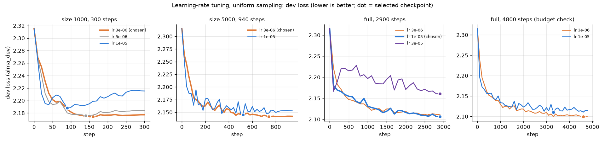
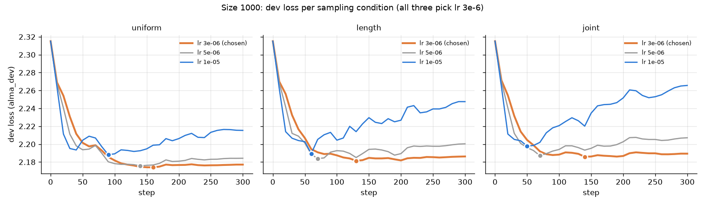

# machine_translation
In this project we aim to build a fast and efficient machine translation system to translate from chinese to english. This project was done in the scope of the Introduction to Large Language Models class (CS4248) at NUS. 

We fine-tune M2M-100 (418M) on Chinese→English ALMA data and compare three ways of sampling the
training data (uniform, length-balanced, joint length × rarity), at several training-set sizes.

## Setup

```bash
conda env create -f environment.yml   # versions are pinned to match the cluster
conda activate mt
```

Then build the data (a few minutes on CPU). On the cluster, run this on the login node: it
downloads ALMA and the tokenizer, and compute nodes may have no internet access.

```bash
bash scripts/prepare_data.sh
```

## Data

Original input files are committed in `data/raw/`; everything else in `data/` is generated by
`scripts/prepare_data.sh` and not committed. It runs, in order:

| Script | Output |
|---|---|
| `audit_alma.py` | Statistics and plots on raw ALMA -> `data/audit/` |
| `prepare_alma.py` | Cleaned ALMA -> `data/processed/alma_{train,dev}.jsonl` |
| `prepare_test_sets.py` | Test sets -> `data/processed/<name>_test.jsonl` |
| `compute_difficulty.py` | Length / rarity features -> `data/features/<split>.csv` |
| `make_bins.py` | Difficulty groups report and heatmap -> `data/features/` |
| `make_subsets.py` | Nested training subsets -> `data/subsets/seed{S}_n{N}.txt` |

**Raw inputs.** `data/raw/canvas/` holds the files from the CS4248 Canvas Project folder, unchanged.
The course guidelines define the official test sets as these files: `wmttest2022.zh` +
`wmttest2022.AnnA.en` (WMT22) and `tatoeba.zh` + `tatoeba.en` (Tatoeba). Canvas also provides
`train.zh-en.{zh,en}`, kept for reference only: it is identical to ALMA-Human-Parallel's `train`
split (apart from a trailing space on 8 lines), and the scripts download ALMA from Hugging Face.
`data/raw/tatoeba/` holds the pinned Tatoeba Challenge files used for the supplementary set.

**Processed files.** Every `.jsonl` line looks like
`{"id": "alma-train-000042", "source": "alma", "zh": "...", "en": "..."}`. Difficulty features are
stored separately, one CSV per split, joined on `id` (column definitions in the docstring of
`scripts/compute_difficulty.py`). Cleaning decisions and checks: `data/processed/alma_cleaning_report.md`
and `data/processed/test_sets_report.md`.

| File (`data/processed/`) | Pairs | Role |
|---|---|---|
| `alma_train.jsonl` | 15,362 | Training (cleaned from 15,406) |
| `alma_dev.jsonl` | 1,002 | Dev: checkpoint selection and tuning |
| `wmt22_test.jsonl` | 1,875 | **Official test set** |
| `tatoeba_test.jsonl` | 469 | **Official test set** |
| `tatoeba_challenge_test.jsonl` | 4,758 | Supplementary test set, never a headline result |

**Test sets are for final evaluation only, never for selection or tuning.**

**Difficulty groups.** Bins are defined once in `scripts/data_utils.py` and assigned with
`assign_bins()`, used by both training and evaluation: length (source subword tokens)
short ≤ 15 < mid_short ≤ 30 < mid_long ≤ 60 < long, and rarity (`rarity_mean`) typical ≤ 7.9 < rare,
giving 8 cells such as `short/rare`. Rationale and the distribution of every split over the cells:
`data/features/bins_report.md` and `bins_heatmap.png`.

**Training subsets.** For each seed (0, 1, 2) the training ids are shuffled once and a subset of
size n (1000, 2000, 5000, full) is the first n ids, so subsets are nested. Run seed s on the subsets
of seed s. Cell counts per subset: `data/subsets/subsets_report.md`.

### Sources

| Dataset | Use | Version | Links |
|---|---|---|---|
| ALMA-Human-Parallel, `zh-en` (Xu et al., 2024) | Training (`train`) and dev / checkpoint selection (`validation`) | Hugging Face revision `4cee1a0e3e1daac4b50a759e8d8659ee2e6595bc` (downloaded 2026-10-13) | [dataset](https://huggingface.co/datasets/haoranxu/ALMA-Human-Parallel), [zh-en files](https://huggingface.co/datasets/haoranxu/ALMA-Human-Parallel/tree/main/zh-en), [code](https://github.com/fe1ixxu/ALMA) |
| WMT22 general test set, zh→en (Kocmi et al., 2022) | **Official test set.** Text from Canvas (`wmttest2022.zh`, `wmttest2022.AnnA.en` = Annotator A) | Canvas files; identical to `wmt22-news-systems` release v1.1 (`xml/wmttest2022.zh-en.all.xml`), from which we add Annotator B, `domain` and `docid` via sacreBLEU (`wmt22`, `zh-en`) | [repository](https://github.com/wmt-conference/wmt22-news-systems), [archive](https://github.com/wmt-conference/wmt22-news-systems/archive/refs/tags/v1.1.tar.gz), [task page](https://www.statmt.org/wmt22/translation-task.html) |
| Tatoeba (Tiedemann, 2020; Tatoeba corpus, CC-BY 2.0 FR) | **Official test set.** 469 Simplified Chinese pairs chosen by the course | Canvas files (`tatoeba.zh`, `tatoeba.en`) | [Tatoeba](https://tatoeba.org) |
| Tatoeba Challenge test set, eng-zho (Tiedemann, 2020) | **Supplementary** test set: Simplified Mandarin rows (`cmn_Hans`), minus sources that appear in the official Tatoeba set | Release v2023-09-26, commit `6faf2da` | [repository](https://github.com/Helsinki-NLP/Tatoeba-Challenge), [file](https://raw.githubusercontent.com/Helsinki-NLP/Tatoeba-Challenge/6faf2dab0b7b01a0e08a114dbacbb7deac54988d/data/test/eng-zho/test.txt), [file history](https://github.com/Helsinki-NLP/Tatoeba-Challenge/commits/master/data/test/eng-zho/test.txt) |
| Tatoeba Challenge test set, 2020 version | Only to flag supplementary pairs that existed in 2020 (`in_v2020` column) | Commit `17a1b96` | [file](https://raw.githubusercontent.com/Helsinki-NLP/Tatoeba-Challenge/17a1b96/data/test/eng-zho/test.txt) |
| M2M-100 418M tokenizer (Fan et al., 2021) | Subword tokenisation for length / rarity features | — | [model](https://huggingface.co/facebook/m2m100_418M) |

Notes:
- **Headline results use only the official test sets**, with Annotator A references for WMT22
  (as in the course guidelines). `en_ref_b` and the supplementary set are for extra analysis only.
- Why a supplementary set: 469 sentences are too few to tell apart systems that differ by about
  1–2 BLEU. The Tatoeba Challenge set (4,758 similar short sentences) is used to check whether
  differences between our sampling conditions on short sentences are real.
- Why `in_v2020`: M2M-100's authors removed the Tatoeba Challenge test sentences available in 2020
  from pretraining; pairs added later were not removed and may have been seen in pretraining.
- ALMA is loaded by name and is not yet pinned to the revision above in the scripts.

## Experimental design

**The conditions only change sampling weights.** Model, loss, optimizer and number of steps are
identical across conditions; only the weights given to `WeightedRandomSampler` change:

- `uniform`: every example has weight 1.
- `length`: each of the 4 length bins gets the same total probability.
- `joint`: each of the 8 length × rarity cells gets the same total probability.

No example is drawn more than `cap` = 3× as often as under uniform. Effect on `seed0_n1000`
(share of training draws, %):

| Group | Natural | Length-balanced | | Cell | Natural | Joint |
|---|---|---|---|---|---|---|
| short | 8.9 | 25.0 | | short/rare | 1.1 | 4.0 (capped at 3×) |
| mid_short | 35.1 | 25.0 | | long/rare | 1.7 | 6.2 (capped at 3×) |
| mid_long | 46.4 | 25.0 | | mid_long/typical | 41.6 | 15.3 |
| long | 9.6 | 25.0 | | … | | |

**Rules that keep the comparison fair:**
- **Matched budget:** at a given size, every condition runs the same number of optimizer steps with
  the same batch size and learning rate. The sampler draws `steps × batch_size` examples with
  replacement instead of looping over epochs.
- **Checkpoint selection on `alma_dev` only:** lowest dev loss, the same way for every condition.
- **`max_length=256`** for source and target. Cleaning removed every longer pair, so nothing is truncated.
- **Seeds:** seed S picks the subset and seeds the training run (sampler, dropout).
- Translation uses `tokenizer.src_lang = "zh"` and `forced_bos_token_id=tokenizer.get_lang_id("en")`.

**Limitation of the joint condition:** balancing over the 8 cells also changes the length mix
(short goes from 8.9% to 19.3%, not to the 25% of the length condition), so "joint minus length"
is not purely the effect of rarity.

**Evaluation:** WMT22 against Annotator A and Tatoeba, with BLEU (sacreBLEU, 13a) and COMET
(`Unbabel/wmt22-comet-da`), as in the course guidelines; chrF as an extra. Results are also broken
down by difficulty group (`assign_bins()` on `data/features/<test set>.csv`). Differences on short
sentences are checked on the supplementary Tatoeba set with paired bootstrap (`sacrebleu --paired-bs`).

## Training

Training runs on the cluster through Slurm. Run everything from the repository root.
Arguments after the `.sbatch` file are forwarded to `scripts/train.py`.

### Submit a run

```bash
# one run: sampling condition, training-set size, seed, and the final settings for that size
sbatch jobs/train1.sbatch --condition joint --size 1000 --seed 0 --lr 3e-6 --steps 300 --warmup_steps 30 --eval_every 10

# longer time limit (default is 30 minutes), set on the command line
sbatch --time=04:00:00 jobs/train1.sbatch --condition uniform --size full --seed 1 --lr 1e-5 --steps 2900 --warmup_steps 290

# no arguments: quick smoke test (20 steps, output in runs_test/)
sbatch jobs/train1.sbatch
```

### Arguments

| Argument | Default | Meaning |
|---|---|---|
| `--condition` | required | Sampling condition: `uniform`, `length` or `joint` |
| `--size` | `1000` | Training subset: `1000`, `2000`, `5000` or `full` |
| `--seed` | `0` | Picks the subset (`seed{S}_n{N}.txt`) and seeds sampler and dropout |
| `--steps` | `1000` | Optimizer steps |
| `--batch_size` | `16` | Examples per step |
| `--lr` | `3e-5` | Peak learning rate (linear warm-up, then linear decay to 0) |
| `--warmup_steps` | `50` | Steps of linear warm-up |
| `--weight_decay` | `0.01` | AdamW weight decay |
| `--eval_every` | `100` | Compute dev loss (and consider saving a checkpoint) every k steps |
| `--cap` | `3.0` | Maximum sampling weight relative to uniform |
| `--out_dir` | `runs` | Parent folder for results |

**The defaults for `steps`, `lr`, `warmup_steps` and `eval_every` are not the final settings.**
Use the values in [Final settings](#final-settings) for each size.

### Monitor a job

```bash
squeue --me                                  # your queued and running jobs (and their job ids)
tail -f logs/slurm/mt-train-<job_id>.out     # follow the log live (Ctrl-C stops following, not the job)
scancel <job_id>                             # cancel a job
```

The log shows the dev loss at step 0 (the pretrained model), then train and dev loss at every
`--eval_every` steps, and finally the best step and greedy dev BLEU.

### Results

Each run writes to `<out_dir>/<condition>_n<size>_seed<seed>/`:

| File | Content |
|---|---|
| `best/` | Checkpoint with the lowest dev loss (model and tokenizer), ~1.9 GB, not committed |
| `dev_curve.csv` | `step`, `train_loss` (mean since the last eval), `dev_loss`. Step 0 is the pretrained model |
| `run_info.json` | All settings, `best_step`, `best_dev_loss`, `dev_bleu_greedy` |

`dev_curve.csv` and `run_info.json` are committed so the whole team can see results.

### Baseline (no fine-tuning)

```bash
sbatch jobs/eval_baseline.sbatch                                          # -> baselines/pretrained.json
sbatch jobs/eval_baseline.sbatch --model runs/joint_n1000_seed0/best      # score a trained checkpoint
```

It reports `dev_loss` and `dev_bleu_greedy`, computed the same way as in `run_info.json`.
Pretrained model on `alma_dev`: dev loss 2.315, BLEU 14.1.

## Hyperparameter tuning

### Final settings

Used by **every condition and every seed** at a given size:

| Size | Learning rate | Steps (epochs) | Warm-up | Eval every | How it was chosen |
|---|---|---|---|---|---|
| 1000 | 3e-6 | 300 (~4.8) | 30 | 10 | Tuned, all 3 conditions (round 1000-2) |
| 2000 | 3e-6 | 375 (~3) | 38 | 20 | Not tuned: 1000 and 5000 both chose 3e-6 |
| 5000 | 3e-6 | 940 (~3) | 94 | 20 | Tuned, uniform (round 5000-1) |
| full | 1e-5 | 2900 (~3) | 290 | 100 | Tuned, uniform (rounds full-1 and full-2) |

Fixed everywhere: batch size 16, weight decay 0.01, dropout 0.1 (M2M-100 default), gradient clipping 1.0, cap 3.0,
warm-up 10% of the steps, checkpoint with the lowest dev loss.

Tuning runs with the final settings that count as final runs (uniform, seed 0, checkpoint kept):
`runs_tune_5000/lr3e-6/uniform_n5000_seed0` and `runs_tune_full/lr1e-5/uniform_nfull_seed0`.
The size-1000 tuning checkpoints were deleted, so uniform seed 0 at 1000 is run again.

### Method

- **Only the learning rate is tuned** (and, at full size, the step budget is checked), on
  `alma_dev`, seed 0. The test sets are never used.
- **Same grid for all conditions at size 1000.** All three conditions chose the same learning rate,
  so larger sizes are tuned with uniform only and the result is used for every condition.
- **The best learning rate depends on size**: 3e-6 at 1000 and 5000 (small data overfits fast),
  1e-5 at full.
- **Step budgets are fixed in advance** (about 3 epochs), not read off the dev curves.
- **Decision rule:** lowest best dev loss; differences below about 0.01 count as a tie, and the
  rule for each round is written down before its results.

### Dev-loss curves

Uniform, every tuned size (dot = selected checkpoint):



Size 1000, the three conditions agree on 3e-6; higher learning rates overfit after 50–90 steps:



Regenerate the figures with `python scripts/plot_tuning.py`. For interactive inspection of any
round (tables, train vs dev loss per run), use `notebooks/tuning.ipynb` with `TUNE_DIR` set to its folder.

### Log of every tuning run

Each job file is edited in place between rounds; git history keeps the old versions.

| Round | Job | Size | Conditions | Learning rates | Steps | Warm-up | Eval every | Results | Outcome |
|---|---|---|---|---|---|---|---|---|---|
| 1000-1 | `jobs/tune.sbatch` | 1000 | all 3 | 1e-5, 3e-5, 1e-4 | 1000 | 50 | 100 | `runs_tune/` | 3e-5 and 1e-4 overfit at once; 1e-5 best for all conditions, at step 100 |
| 1000-2 | `jobs/tune.sbatch` | 1000 | all 3 | 3e-6, 5e-6, 1e-5 | 300 | 30 | 10 | `runs_tune2/` | 3e-6 lowest dev loss for all conditions; best step 130-160 |
| full-1 | `jobs/tune_full.sbatch` | full | uniform | 3e-6, 1e-5, 3e-5 | 2900 | 290 | 100 | `runs_tune_full/` | 1e-5 best; best step = last step (2900) |
| full-2 | `jobs/tune_full.sbatch` | full | uniform | 3e-6, 1e-5 | 4800 | 480 | 100 | `runs_tune_full2/` | no real gain from more steps; keep 2900 |
| 5000-1 | `jobs/tune_5000.sbatch` | 5000 | uniform | 3e-6, 1e-5 | 940 | 94 | 20 | `runs_tune_5000/` | 3e-6 best; 1e-5 overfits after step 520 |

### Results per round

Best dev loss / dev BLEU (greedy) / best step.

**Size 1000 (round 1000-2).** Round 1000-1 found the best point within the first 100 steps and the
lowest learning rate tried as best, so this round tries lower rates and evaluates more often.

| lr | uniform | length | joint |
|---|---|---|---|
| 3e-6 | **2.174** / 14.98 / 160 | **2.181** / 14.87 / 130 | **2.186** / 14.95 / 140 |
| 5e-6 | 2.176 / 15.08 / 140 | 2.184 / 14.74 / 70 | 2.187 / 14.80 / 70 |
| 1e-5 | 2.188 / 14.90 / 90 | 2.189 / 14.64 / 60 | 2.198 / 14.72 / 50 |

3e-6 has the lowest dev loss for every condition and stays flat up to step 300 instead of rising.
BLEU differences are at most 0.3, within seed noise.

**Size 5000 (round 5000-1).**

| lr | uniform |
|---|---|
| 3e-6 | **2.141** / **15.46** / 740 |
| 1e-5 | 2.145 / 15.40 / 520 |

A tie by the rule (gap 0.004); 3e-6 has the lower dev loss and 1e-5 starts to overfit after step 520.

**Full size (rounds full-1 and full-2).**

| lr | 2900 steps | 4800 steps |
|---|---|---|
| 3e-6 | 2.110 / 15.71 / 2600 | 2.099 / 16.06 / 4600 |
| 1e-5 | **2.106** / **16.33** / 2900 | 2.110 / 16.06 / 3300 |
| 3e-5 | 2.161 / 15.90 / 2900 | — |

At 2900 steps, 1e-5 is best on both dev loss and BLEU and sits in the middle of the grid; 3e-5
overfits. Its best checkpoint was the last step, but the curve is nearly flat by then and the
learning rate decays to 0, so full-2 checked a longer budget with a rule fixed beforehand: switch to
4800 steps only if 1e-5 improves by about 0.01. It got slightly worse (2.110), and 3e-6 improved by
only 0.007 with lower BLEU, so the budget stays at 2900.
