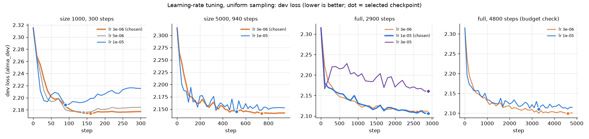

# Experiments

## Data

| File (`data/processed/`) | Pairs | Role |
|---|---|---|
| `alma_train.jsonl` | 15,362 | Training (ALMA-Human-Parallel zh-en, cleaned) |
| `alma_dev.jsonl` | 1,002 | Checkpoint selection and tuning |
| `wmt22_test.jsonl` | 1,875 | Official test set (Annotator A references) |
| `tatoeba_test.jsonl` | 469 | Official test set |
| `tatoeba_challenge_test.jsonl` | 4,758 | Supplementary test set, extra analysis only |

Test sets are never used for selection or tuning. Cleaning details:
`data/processed/alma_cleaning_report.md` and `data/processed/test_sets_report.md`.

**Difficulty bins** (defined in `scripts/data_utils.py`, `assign_bins()`):
- Length (source subword tokens): short ≤ 15 < mid_short ≤ 30 < mid_long ≤ 60 < long
- Rarity (`rarity_mean`): typical ≤ 7.9 < rare → 8 length × rarity cells
- Loss (`loss_mean` of the pretrained model): hard if 2.95 < loss ≤ 4.16 (p90–p99), otherwise other

**Training subsets:** for each seed (0, 1, 2) the training ids are shuffled once; size n
(1000, 2000, 5000, full) takes the first n, so subsets are nested.

**ALMA + News Commentary (optional):** put the OPUS archive at
`data/external/news_commentary/news-commentary-v16.en-zh.tsv.gz`, then run
`prepare_news_commentary.py`, `audit_news_alma_overlap.py`, `merge_alma_news.py` and
`compute_alma_news_difficulty.py` (all in `scripts/`). Train with `--dataset alma_news`.

## Sampling conditions

Only the weights given to `WeightedRandomSampler` change between conditions:

- `uniform`: every example has weight 1.
- `length`: each of the 4 length bins gets equal total probability.
- `joint`: each of the 8 length × rarity cells gets equal total probability.
- `loss`: the hard and other loss groups get equal total probability.

No example is drawn more than 3× as often as under uniform (`--cap 3`).

**Fairness rules:** at a given size every condition uses the same steps, batch size and learning
rate; the sampler draws `steps × batch_size` examples with replacement; the checkpoint with the
lowest `alma_dev` loss is kept.

**Evaluation:** BLEU (sacreBLEU), chrF and COMET (`Unbabel/wmt22-comet-da`) on WMT22 and
Tatoeba, with greedy and beam-4 decoding.

## Learning-rate tuning

Only the learning rate was tuned, on `alma_dev`, seed 0. At size 1000 all three of uniform, length
and joint picked the same value, so larger sizes were tuned with uniform only.

### Final settings (every condition and seed)

| Size | LR | Steps | Warm-up | Eval every |
|---|---|---|---|---|
| 1000 | 3e-6 | 300 | 30 | 10 |
| 2000 | 3e-6 | 375 | 38 | 20 |
| 5000 | 3e-6 | 940 | 94 | 20 |
| full | 1e-5 | 2900 | 290 | 100 |

Fixed: batch size 16, weight decay 0.01, cap 3.0. Size 2000 was not tuned (1000 and 5000 both
chose 3e-6).

### Results (best dev loss)

| Size | Tried | Chosen | Folder |
|---|---|---|---|
| 1000 | 1e-5, 3e-5, 1e-4, then 3e-6, 5e-6, 1e-5 | 3e-6 (2.174) | `runs_tune/`, `runs_tune2/` |
| 5000 | 3e-6, 1e-5 | 3e-6 (2.141) | `runs_tune_5000/` |
| full | 3e-6, 1e-5, 3e-5 (also 4800 steps) | 1e-5, 2900 steps (2.106) | `runs_tune_full/`, `runs_tune_full2/` |

Higher learning rates overfit on small data; with full data 1e-5 is best and 4800 steps gave no gain.

Figures: `python scripts/plot_tuning.py`. Interactive: `notebooks/tuning.ipynb`.
